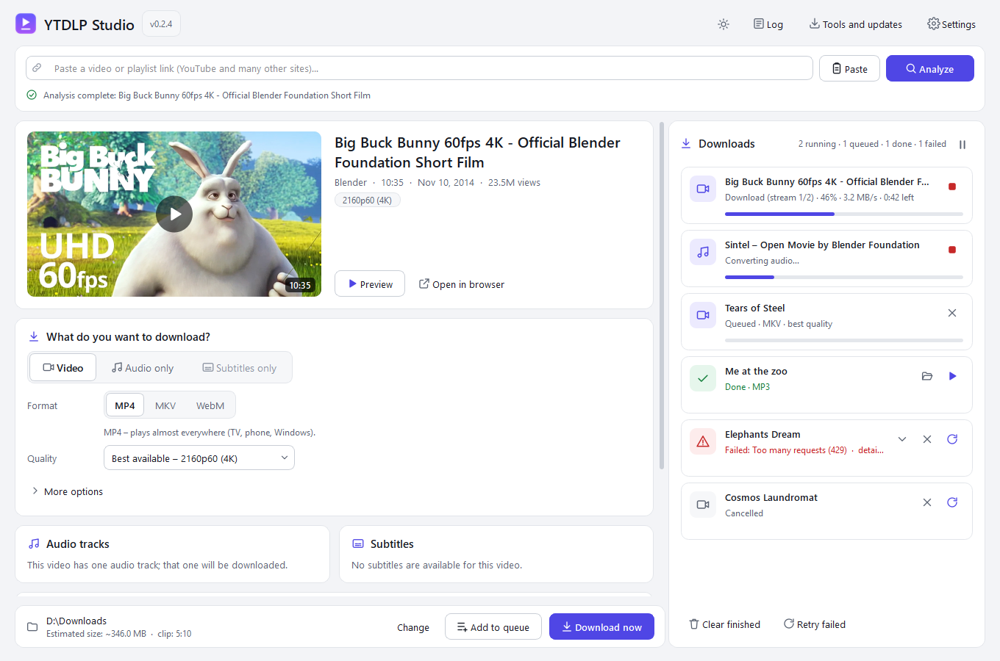

# YTDLP Studio

[Magyar leírás](README.md) · **English**

**A free, portable video and audio downloader for Windows**, built on
[yt-dlp](https://github.com/yt-dlp/yt-dlp). Download videos, music or subtitles – even just a
selected clip – without using the command line. The interface is available in **English and
Hungarian**.



> Only download content you have the right to (your own, openly licensed, or permitted by the
> service). The app does not circumvent DRM.

## Features

- **Video** in MP4, MKV or WebM, quality up to 4K/8K where available, without re-encoding. For MP4
  the most compatible codec is preferred at the same resolution. Estimated file size before
  downloading.
- **Audio only**: MP3, M4A, AAC, Opus, FLAC, WAV, or the original track without re-encoding, with
  cover art and metadata.
- **Subtitles only**: SRT or VTT.
- **Subtitles**: original (uploaded), automatic (speech recognition) and YouTube auto-translated
  subtitles; several languages at once; as separate files or embedded with language tags.
- **Multi-language audio tracks** (dubs): one or more tracks; several tracks in one MKV with
  language tags, or as separate files in audio mode. A track is labeled “AI dub” only if YouTube
  marks it so.
- **Trimming**: timeline with two handles, editable times, chapter picker, start/end from the
  built-in preview player. Only the selected section is downloaded; fast (no re-encoding) or
  precise cut; subtitle timing is adjusted too.
- **Playlists and channels**: list view with selection, search, subfolder and numbering.
- **Download queue**: “Download now” or “Add to queue”; progress, speed, time left, cancel,
  retry, open the finished file or its folder; warnings and errors expand inline.
- **yt-dlp updates** from inside the app (Stable or Nightly), SHA-256 verified, with rollback to
  the previous version.
- Light/dark theme, DPI scaling, clear error messages, detailed log.
- **Portable**: no Python, FFmpeg or other installation needed; runs from a USB drive and keeps
  its settings in its own `data` folder. No ads, tracking or telemetry.

## Getting started (portable version)

1. Download `YTDLPStudio-0.3.0-Windows-x64-portable.zip` from
   [Releases](https://github.com/X1wer/YTDLP-Studio/releases).
2. Extract it to a **writable** folder (e.g. `Documents\YTDLPStudio` or a USB drive). Do not run it
   from inside the ZIP.
3. Start `YTDLPStudio.exe`. (Windows SmartScreen may warn on first start because the app is not
   code-signed: “More info” → “Run anyway”.)
4. The language follows Windows by default; change it under **Settings → Nyelv / Language**.

## Usage

1. **Paste a link** – copy a video or playlist link and click **Paste** (or drag the link onto the
   window, or type it and press Enter).
2. **Analyze** – the app fetches the title, length, qualities, audio tracks and subtitles.
3. **What do you want to download?** – choose *Video*, *Audio only* or *Subtitles only*, then the
   format and quality. Less common options are under *More options*.
4. **Audio tracks, subtitles** – tick the languages you want (with search and type filter). If no
   audio track is selected, the original audio is used.
5. **Trim (optional)** – turn on *Download only a clip* and drag the handles or type the times
   (e.g. `00:15:30` – `01:42:00`).
6. **Download now** (starts immediately) or **Add to queue** (starts in turn).
7. Open the finished file (▶) or its folder in the **Downloads** panel on the right.

Shortcuts: `Enter` – analyze, `Ctrl+L` – link field, `Ctrl+Enter` – download now, `F5` – analyze again.

## Bot checks and “too many requests”

YouTube limits how many requests it accepts from one network in a short time. After many
analyses or downloads it may temporarily ask for a “bot check” or answer with HTTP 429. This
usually clears by itself within minutes to hours.

- **Fewer requests:** a download (including subtitles) contacts YouTube only once, during
  analysis; the download itself reuses that data. Playlists are downloaded at a gentle pace.
- **Automatic waiting:** when limited, the queue starts no new downloads for 15 minutes (with a
  countdown and a “Resume now” button), then continues and retries the affected download once.
- **Why the check cannot be completed in the app:** YouTube does not send downloaders a solvable
  challenge – it simply rejects the request, so there is nothing to show (and nothing appears in
  a normal browser, because YouTube's own player proves itself with internal tokens that
  downloaders do not get). The app does not try to imitate or bypass this.
- **Auto-translated subtitles:** YouTube currently shows them only in its own player and refuses
  downloads (429) even after waiting. The video is still downloaded; the missing subtitle is
  explained on the download card. Original-language and automatic subtitles work.

## Known limitations

- Fast cuts may start at the nearest keyframe (a few tenths of a second); precise cuts re-encode
  the clip (slower, especially for WebM).
- Live streams cannot be trimmed; downloading one lasts until the stream ends.
- Reading cookies from Chrome/Edge often fails because of their encryption; Firefox is
  recommended for age-restricted videos.
- The app is not code-signed.

## Building from source

Requirements: Windows 10/11 x64, **Python 3.11–3.13 (64-bit)**, internet access.

```powershell
build\build_windows.cmd
```

The script downloads the latest official **yt-dlp**, **Deno** and **FFmpeg** (BtbN win64-gpl)
releases with SHA-256 verification, installs PyInstaller and PySide6 into a local `.build-venv`,
runs the tests, then creates `dist\YTDLPStudio\` and
`dist\YTDLPStudio-<version>-Windows-x64-portable.zip` (+ `.sha256`).
`-OfflineTools` reuses the tools already in `bin\`; `-SkipTests` skips the tests.

Run from source and run the tests:

```powershell
python -m venv .build-venv
.build-venv\Scripts\python -m pip install -r build\requirements-build.txt
.build-venv\Scripts\python start.py
cd tests
..\.build-venv\Scripts\python -m unittest discover -s .
```

## Translations

User-facing texts are written in Hungarian in the source and go through `tr()`
(`src/ytstudio/i18n.py`); the English strings live in `src/ytstudio/i18n_en.py`. The test
`tests/test_i18n.py` fails if a string has no English translation, if placeholders differ, or if
any Hungarian text remains visible in the English UI.

## Licenses

| Component | Purpose | License |
|---|---|---|
| YTDLP Studio | the app | MIT |
| [yt-dlp](https://github.com/yt-dlp/yt-dlp) | extraction and download | Unlicense |
| [FFmpeg](https://ffmpeg.org/) ([BtbN build](https://github.com/BtbN/FFmpeg-Builds)) | merging, converting, cutting | GPL v3 |
| [Deno](https://deno.com/) | YouTube JavaScript checks | MIT |
| [Qt 6 / PySide6](https://doc.qt.io/qtforpython/) | user interface, preview | LGPL v3 |
| Python 3.11 | runtime | PSF |
| PyInstaller | packaging | GPL with bootloader exception |

Full license texts are in the `licenses` folder (in the source: `docs/licenses`). The app only
contacts the links you enter, preview images and – on request – GitHub release pages.
