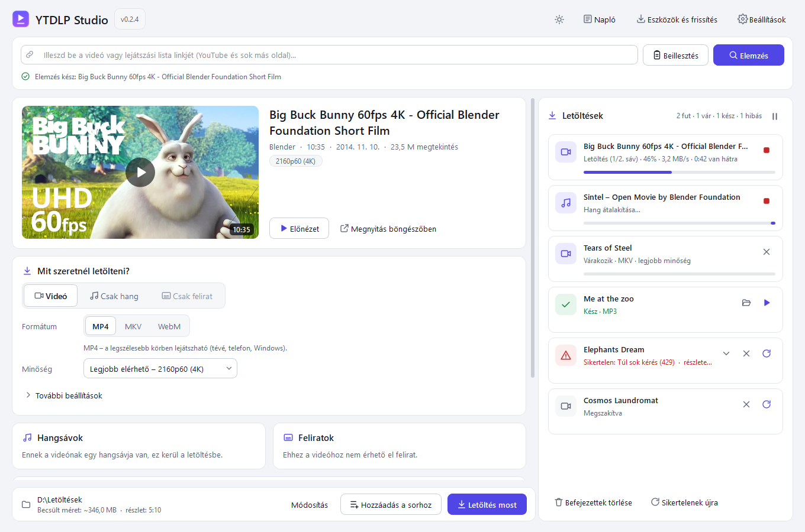

# YTDLP Studio

**Magyar nyelvű, ingyenes, telepítés nélkül használható videó- és hangletöltő Windowsra**, a
[yt-dlp](https://github.com/yt-dlp/yt-dlp) alapjaira építve. Parancssori ismeret nélkül
tölthetsz le videót, zenét vagy feliratot – akár csak egy kiválasztott részletet.



> Csak olyan tartalmat tölts le, amelyhez jogod van (pl. saját, nyílt licencű vagy a
> szolgáltatás által engedélyezett tartalom). A program DRM-védelmet nem kerül meg.

## Funkciók

- **Videó letöltése** MP4, MKV vagy WebM formátumban, választható minőséggel (4K-ig, ha
  elérhető), újrakódolás nélkül. MP4-nél azonos felbontáson a legjobban lejátszható kodeket
  választja. Becsült fájlméret már letöltés előtt.
- **Csak hang**: MP3, M4A, AAC, Opus, FLAC, WAV vagy az eredeti hangsáv átkódolás nélkül,
  borítóképpel és metaadatokkal.
- **Csak felirat**: SRT vagy VTT.
- **Feliratok**: eredeti (feltöltött), automatikus (beszédfelismerés) és a YouTube által
  automatikusan fordított feliratok; több nyelv egyszerre; külön fájlba vagy a videóba
  ágyazva, nyelvi címkével.
- **Többnyelvű hangsávok** (pl. szinkronok): egy vagy több sáv; több sáv egy MKV-fájlba
  nyelvi címkével, hang módban pedig külön fájlokba. „AI-szinkron” címkét csak akkor mutat,
  ha a YouTube így jelöli.
- **Időbeli vágás**: idővonal két végponttal, kézzel írható időpontok, fejezetválasztó,
  előnézet-lejátszóból kijelölhető kezdő- és végpont. Csak a kért szakasz töltődik le;
  gyors (újrakódolás nélküli) vagy pontos vágás; a feliratok időzítése is igazodik.
- **Lejátszási listák és csatornák**: listanézet kijelöléssel, kereséssel, almappával és
  sorszámozással.
- **Letöltési sor**: „Letöltés most” vagy „Hozzáadás a sorhoz”; haladás, sebesség,
  hátralévő idő, megszakítás, újrapróbálás, kész fájl és mappa megnyitása.
- **yt-dlp frissítés** a programból (Stable vagy Nightly), SHA-256 ellenőrzéssel és az előző
  verzió visszaállításának lehetőségével.
- Világos/sötét téma, DPI-skálázás, érthető magyar hibaüzenetek, részletes napló.
- **Portable**: nem kell Python, FFmpeg vagy más telepítés; USB-meghajtóról is fut, a
  beállításokat a saját `data` mappájába menti. Nincs reklám, követőkód vagy telemetria.

## Indítás (portable verzió)

1. Töltsd le a `YTDLPStudio-0.2.2-Windows-x64-portable.zip` fájlt.
2. Csomagold ki egy **írható** mappába (pl. `Dokumentumok\YTDLPStudio` vagy pendrive).
   Ne a ZIP-ből közvetlenül indítsd.
3. Indítsd el a `YTDLPStudio.exe` fájlt. (Az első indításkor a Windows SmartScreen
   figyelmeztethet, mert a program nincs digitálisan aláírva: „További információ” →
   „Futtatás mindenképp”.)

A mappa tartalma:

```text
YTDLPStudio.exe        a program
_internal\             a program futtatókörnyezete (Python, Qt) – ne töröld
bin\                   yt-dlp.exe, ffmpeg.exe, ffprobe.exe, deno.exe
licenses\              licencek és harmadik féltől származó összetevők
data\                  beállítások, napló, gyorsítótár (első indításkor jön létre)
README.md, CHANGELOG.md, VERSIONS.txt
```

## Használat

1. **Link beillesztése** – másold ki a videó vagy lejátszási lista linkjét, majd kattints a
   **Beillesztés** gombra (vagy húzd a linket az ablakra, vagy írd be és nyomj Entert).
2. **Elemzés** – a program lekéri a videó adatait (cím, hossz, minőségek, hangsávok,
   feliratok). Ez néhány másodperc; közben a gomb „Mégse” lesz.
3. **Mit szeretnél letölteni?** – válaszd a *Videó*, *Csak hang* vagy *Csak felirat* módot,
   majd a formátumot és a minőséget. Ritkább beállítások a *További beállítások* alatt.
4. **Hangsávok, feliratok** – jelöld be a kívánt nyelveket (keresővel, típusszűrővel).
   Ha nem jelölsz hangsávot, az eredeti hang kerül a fájlba.
5. **Vágás (opcionális)** – kapcsold be a *Csak egy részlet letöltése* kapcsolót, és húzd a
   végpontokat vagy írd be az időket (pl. `00:15:30` – `01:42:00`).
6. **Letöltés most** (azonnal indul) vagy **Hozzáadás a sorhoz** (sorra kerülve indul).
7. A jobb oldali **Letöltések** panelen nyisd meg a kész fájlt (▶) vagy a mappáját.

Billentyűk: `Enter` – elemzés, `Ctrl+L` – linkmező, `Ctrl+Enter` – Letöltés most,
`F5` – újraelemzés.

## Gyakori hibák

| Üzenet | Teendő |
|---|---|
| *Hozzáférés megtagadva (403)* / *YouTube-ellenőrzés sikertelen* | **Eszközök és frissítés** → yt-dlp frissítése (szükség esetén Nightly csatorna). |
| *A YouTube ellenőrzést kér* (robotellenőrzés) | A program magától kivár (lásd lent); ha tartósan fennáll, frissítsd a yt-dlp-t, vagy a Beállításokban válassz böngészősütiket (Firefox ajánlott). |
| *Túl sok kérés (429)* automatikusan fordított feliratnál | A YouTube jelenleg gyakran elutasítja a fordított feliratok letöltését. Válaszd az eredeti nyelvű feliratot, vagy próbáld később. A videó ettől még letöltődik. |
| *Korhatáros videó* | Bejelentkezett böngésző sütijei szükségesek (Beállítások → Böngészősütik). |
| *A kért formátum nem érhető el* | Válassz „Legjobb elérhető” minőséget vagy másik formátumot. |
| *Hiányzik: ffmpeg / yt-dlp* | Csomagold ki újra a teljes ZIP-et; a `bin` mappának a program mellett kell lennie. |
| *Nincs írási jogosultság* | Válassz másik mentési mappát, vagy ne a `Program Files` mappából futtasd. |

Részletek: **Napló** gomb, illetve `data\logs\ytdlp-studio.log`.

### Robotellenőrzés és „túl sok kérés” – mit csinál a program?

A YouTube hálózatonként (IP-címenként) korlátozza, hány kérést fogad el rövid idő alatt.
Sok egymás utáni elemzés vagy letöltés után ideiglenesen „robotellenőrzést” kér, vagy
429-es („túl sok kérés”) hibát ad. Ez általában néhány perc–óra alatt magától megszűnik.

- **Kevesebb kérés:** egy letöltés – feliratokkal együtt – csak az elemzéskor kérdezi le a
  YouTube-ot; maga a letöltés az elemzés adataiból dolgozik. Lejátszási listáknál a program
  rövid szüneteket tart a kérések között.
- **Automatikus várakozás:** korlátozáskor a letöltési sor 15 percig nem indít új letöltést
  (a panelen visszaszámláló és „Folytatás most” gomb látszik), utána magától folytatódik, és
  az érintett letöltést egyszer újrapróbálja.
- **Ellenőrzés a böngészőben (ha nem akarsz várni, vagy tartósan fennáll):** a YouTube a
  letöltőprogramoknak nem küld kitölthető ellenőrzést, csak elutasítja a kérést, ezért az
  ellenőrzés a programban nem jeleníthető meg. Helyette a hibánál (vagy a letöltési kártya
  pajzs ikonjával) megnyíló **„Ellenőrzés a böngészőben”** ablak végigvezet: 1) megnyitja a
  videót a böngésződben, ahol bejelentkezhetsz / elvégezheted az ellenőrzést; 2) kiválasztod a
  böngészőt (Firefox ajánlott – a Chrome-alapú böngészők sütijei titkosítás miatt gyakran nem
  olvashatók); 3) a program a böngésző munkamenetével újrapróbálja. A sütiket a program nem
  menti el, csak a lekéréshez olvassa. Nagyon sok letöltés bejelentkezett fiókkal a fiók
  korlátozásával is járhat. Ha ez sem segít, frissítsd a yt-dlp-t (Eszközök és frissítés).
- A program nem kerüli meg a robotellenőrzést, csak kivár és kevesebb kérést küld.

## Ismert korlátozások

- A YouTube automatikusan fordított feliratainak letöltését a szolgáltató jelenleg gyakran
  429-es hibával elutasítja (2026 novemberében tesztelve); az eredeti és az automatikus
  (beszédfelismeréses) feliratok működnek.
- Gyors vágásnál a kép a legközelebbi kulcskockánál kezdődhet (néhány tized másodperc);
  a pontos vágás a részletet újrakódolja (lassabb). WebM pontos vágása különösen lassú.
- Élő közvetítés vágása nem támogatott; élő adás letöltése a közvetítés végéig tart.
- Az előnézet-lejátszó a videó alacsony felbontású változatát játssza le; ha egy oldalon
  nem érhető el, a „Megnyitás böngészőben” gomb használható.
- Chrome/Edge újabb verzióinál a sütik titkosítása miatt a böngészősütik olvasása
  sikertelen lehet; Firefox ajánlott.
- A program nincs digitálisan aláírva (SmartScreen-figyelmeztetés lehetséges).
- A program saját frissítéskeresője a GitHub-tároló közzététele után kapcsolható be
  (`src/ytstudio/__init__.py` → `APP_REPO`).

## Buildelés forrásból

Követelmény: Windows 10/11 x64, **Python 3.11–3.13 (64 bites)**, internetkapcsolat.

```powershell
build\build_windows.cmd
```

vagy PowerShellből: `powershell -ExecutionPolicy Bypass -File build\build_windows.ps1`

A szkript:
1. letölti a legfrissebb hivatalos **yt-dlp**, **Deno** és **FFmpeg** (BtbN, win64-gpl)
   kiadást, és SHA-256-tal ellenőrzi őket (a már letöltötteket újrahasznosítja);
2. projektlokális `.build-venv` környezetbe telepíti a PyInstallert és a PySide6-ot;
3. lefuttatja az automatikus teszteket (`-SkipTests` kapcsolóval kihagyható);
4. elkészíti a `dist\YTDLPStudio\` portable mappát és a
   `dist\YTDLPStudio-<verzió>-Windows-x64-portable.zip` csomagot (+ `.sha256`).

`-OfflineTools`: a `bin\` mappában lévő eszközöket használja, letöltés nélkül.
GitHub Actions: a `.github/workflows/build-windows.yml` ugyanezt futtatja Windows-runneren.

### Forrásból futtatás és tesztek

```powershell
python -m venv .build-venv
.build-venv\Scripts\python -m pip install -r build\requirements-build.txt
.build-venv\Scripts\python start.py
cd tests
..\.build-venv\Scripts\python -m unittest discover -s .
..\.build-venv\Scripts\python live_check.py      # valós hálózati ellenőrzés (kb. 3 perc)
```

Forrásból futtatáshoz a `yt-dlp.exe`, `ffmpeg.exe`, `ffprobe.exe` és `deno.exe` a `bin\`
mappába kell (a buildszkript letölti őket).

## Projektszerkezet

```text
src/ytstudio/        forráskód
  core.py            metaadatok értelmezése, formátumválasztás, yt-dlp-argumentumok
  engine.py          elemzés, letöltés, haladás, feliratok, vágás, véglegesítés
  subtitles.py       SRT/VTT vágás és időeltolás
  updater.py         yt-dlp frissítés (stable/nightly, SHA-256, visszaállítás)
  errors.py          magyar hibamagyarázatok
  langs.py           nyelvnevek, ISO 639-2 kódok
  settings.py        portable mappák és beállítások
  ui/                Qt-felület (főablak, sor, párbeszédablakok, vezérlők, téma, ikonok)
assets/              ikon
tests/               automatikus tesztek, minták, élő ellenőrzés
build/               buildszkriptek, PyInstaller-leírás, ikongenerátor
docs/                licencek, tesztjelentés, képernyőképek
dist/                kész portable mappa és ZIP (build után)
```

## Függőségek és licencek

| Összetevő | Szerep | Licenc |
|---|---|---|
| YTDLP Studio | a program | MIT |
| [yt-dlp](https://github.com/yt-dlp/yt-dlp) | videóadatok és letöltés | Unlicense |
| [FFmpeg](https://ffmpeg.org/) ([BtbN-build](https://github.com/BtbN/FFmpeg-Builds)) | összefűzés, konvertálás, vágás | GPL v3 |
| [Deno](https://deno.com/) | YouTube JavaScript-ellenőrzései | MIT |
| [Qt 6 / PySide6](https://doc.qt.io/qtforpython/) | grafikus felület, előnézet | LGPL v3 |
| Python 3.11 | futtatókörnyezet | PSF |
| PyInstaller | csomagolás | GPL + bootloader-kivétel |

A teljes licencszövegek és a forrásokra vonatkozó tájékoztatás a `licenses` mappában
(forrásban: `docs/licenses`) található. A program nem küld adatot a felhasználó tudta
nélkül: hálózati kérés csak a megadott linkekhez, az előnézeti képekhez és – kérésre – a
GitHub kiadási oldalaihoz történik.

A YTDLP Studio saját kódja MIT-licencű (`LICENSE`).
